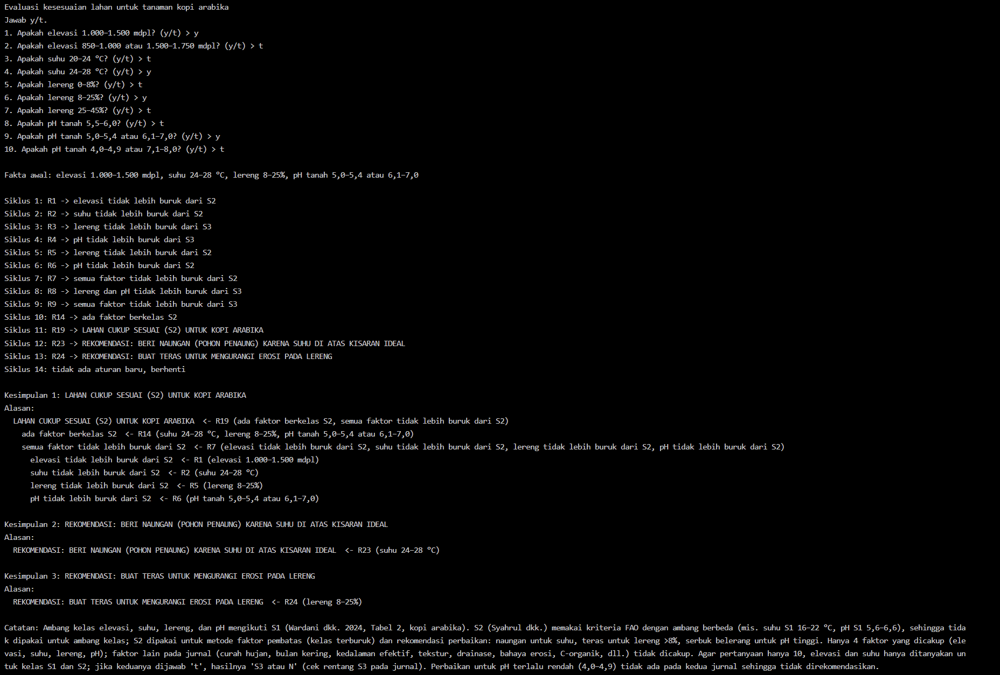
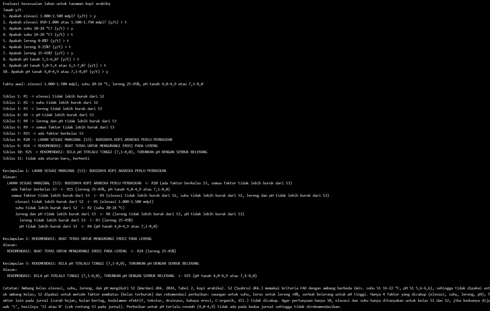
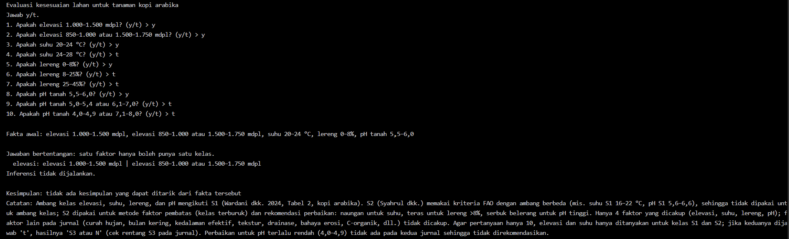

# Sistem Pakar Evaluasi Kesesuaian Lahan untuk Tanaman Kopi Arabika

## NURHIDAYAH MAULIDIA (F1D02410022)

## Topik dan Cara Menjalankan Program

**Topik:** evaluasi kesesuaian lahan untuk tanaman kopi arabika berdasarkan empat faktor, yaitu elevasi, suhu, lereng, dan pH tanah. Sistem menyimpulkan kelas kesesuaian lahan (S1 sangat sesuai, S2 cukup sesuai, S3 sesuai marginal, N tidak sesuai) beserta rekomendasi perbaikan dan alasannya.

**Bahasa dan versi:** Python 3.12.3 (minimal Python 3.6). Hanya memakai modul bawaan (`json`, `pathlib`), sehingga tidak perlu menginstal library tambahan.

**Struktur berkas:**

- `mesin.py`: mesin inferensi forward chaining yang ditulis sendiri.
- `rules.json`: basis pengetahuan (25 aturan, judul, sumber, dan batas keberlakuan).
- `README.md`: dokumen ini.
- `Screenshot/`: screenshot tiga kasus uji.

**Cara menjalankan** (dari folder yang berisi `mesin.py` dan `rules.json`):

```
python mesin.py
```

Program menanyakan 10 fakta dasar dengan jawaban `y` (ya) atau `t` (tidak). Setelah semua pertanyaan dijawab, program menampilkan jejak siklus inferensi, kesimpulan, alasan, dan catatan batas keberlakuan. Jawaban selain `y` atau `t` ditolak dan pertanyaan diulang. Bila satu faktor (elevasi, suhu, lereng, atau pH) dijawab `y` pada lebih dari satu kelas, program menyatakan jawaban bertentangan dan tidak menjalankan inferensi.

## Daftar Sumber dan Tabel Aturan

### Daftar sumber

| Kode | Judul | Penerbit | URL | Tanggal akses |
|---|---|---|---|---|
| S1 | Evaluasi Kesesuaian Lahan Kopi di Wilayah Giripurno Kota Batu Jawa Timur (Wardani, N. R., Putra, D. F., & Supriyanto, A.), Vol. 9 No. 1, Agustus 2024 | Jurnal Swarnabhumi (Universitas PGRI Palembang) | https://jurnal.univpgri-palembang.ac.id/index.php/swarna/article/view/10961/8701 | [isi tanggal akses] |
| S2 | Evaluasi Kesesuaian Lahan untuk Pengembangan Tanaman Kopi Arabika (Coffea arabica L.) di Kecamatan Bungaya, Kabupaten Gowa (Syahrul, Amir, & Saida) | Jurnal AGrotekMAS, Fakultas Pertanian UMI Makassar | https://jurnal.fp.umi.ac.id/index.php/agrotekmas/article/download/191/167 | [isi tanggal akses] |

Pembagian peran sumber: ambang kelas elevasi, suhu, lereng, dan pH mengikuti S1 (Tabel 2, kopi arabika). S2 dipakai untuk metode faktor pembatas (kelas terburuk) dan rekomendasi perbaikan (naungan, teras, serbuk belerang).

### Tabel aturan

Aturan dengan mode ATAU terpenuhi bila salah satu kondisi ada, mode DAN bila semua kondisi ada, dan mode TIDAK bila tidak satu pun kondisi dijawab ya. Kondisi yang bukan fakta dasar adalah hasil dari aturan lain (rantai inferensi).

| ID | JIKA | Mode | MAKA | Sumber |
|---|---|---|---|---|
| R1 | elevasi 1.000–1.500 mdpl; elevasi 850–1.000 atau 1.500–1.750 mdpl | ATAU | elevasi tidak lebih buruk dari S2 | S1 |
| R2 | suhu 20–24 °C; suhu 24–28 °C | ATAU | suhu tidak lebih buruk dari S2 | S1 |
| R3 | lereng 0–8%; lereng 8–25%; lereng 25–45% | ATAU | lereng tidak lebih buruk dari S3 | S1 |
| R4 | pH tanah 5,5–6,0; pH tanah 5,0–5,4 atau 6,1–7,0; pH tanah 4,0–4,9 atau 7,1–8,0 | ATAU | pH tidak lebih buruk dari S3 | S1 |
| R5 | lereng 0–8%; lereng 8–25% | ATAU | lereng tidak lebih buruk dari S2 | S1 |
| R6 | pH tanah 5,5–6,0; pH tanah 5,0–5,4 atau 6,1–7,0 | ATAU | pH tidak lebih buruk dari S2 | S1 |
| R7 | elevasi tidak lebih buruk dari S2; suhu tidak lebih buruk dari S2; lereng tidak lebih buruk dari S2; pH tidak lebih buruk dari S2 | DAN | semua faktor tidak lebih buruk dari S2 | S1, S2 |
| R8 | lereng tidak lebih buruk dari S3; pH tidak lebih buruk dari S3 | DAN | lereng dan pH tidak lebih buruk dari S3 | S1, S2 |
| R9 | elevasi tidak lebih buruk dari S2; suhu tidak lebih buruk dari S2; lereng dan pH tidak lebih buruk dari S3 | DAN | semua faktor tidak lebih buruk dari S3 | S1, S2 |
| R10 | elevasi 1.000–1.500 mdpl; elevasi 850–1.000 atau 1.500–1.750 mdpl | TIDAK ADA yang dijawab ya | elevasi di luar kisaran S1–S2 | S1 |
| R11 | suhu 20–24 °C; suhu 24–28 °C | TIDAK ADA yang dijawab ya | suhu di luar kisaran S1–S2 | S1 |
| R12 | lereng 0–8%; lereng 8–25%; lereng 25–45% | TIDAK ADA yang dijawab ya | lereng tidak sesuai (N) | S1 |
| R13 | pH tanah 5,5–6,0; pH tanah 5,0–5,4 atau 6,1–7,0; pH tanah 4,0–4,9 atau 7,1–8,0 | TIDAK ADA yang dijawab ya | pH tidak sesuai (N) | S1 |
| R14 | elevasi 850–1.000 atau 1.500–1.750 mdpl; suhu 24–28 °C; lereng 8–25%; pH tanah 5,0–5,4 atau 6,1–7,0 | ATAU | ada faktor berkelas S2 | S1 |
| R15 | lereng 25–45%; pH tanah 4,0–4,9 atau 7,1–8,0 | ATAU | ada faktor berkelas S3 | S1 |
| R16 | elevasi 1.000–1.500 mdpl; suhu 20–24 °C; lereng 0–8%; pH tanah 5,5–6,0 | DAN | semua faktor berkelas S1 | S1 |
| R17 | elevasi di luar kisaran S1–S2; suhu di luar kisaran S1–S2 | ATAU | elevasi atau suhu di luar kisaran S1–S2 | S1 |
| R18 | semua faktor berkelas S1 | DAN | LAHAN SANGAT SESUAI (S1) UNTUK KOPI ARABIKA | S1, S2 |
| R19 | ada faktor berkelas S2; semua faktor tidak lebih buruk dari S2 | DAN | LAHAN CUKUP SESUAI (S2) UNTUK KOPI ARABIKA | S1, S2 |
| R20 | ada faktor berkelas S3; semua faktor tidak lebih buruk dari S3 | DAN | LAHAN SESUAI MARGINAL (S3): BUDIDAYA KOPI ARABIKA PERLU PERBAIKAN | S1, S2 |
| R21 | elevasi atau suhu di luar kisaran S1–S2; lereng dan pH tidak lebih buruk dari S3 | DAN | LAHAN SESUAI MARGINAL (S3) ATAU TIDAK SESUAI (N): ELEVASI/SUHU DI LUAR KISARAN S1–S2, CEK RENTANG S3 PADA JURNAL | S1 |
| R22 | lereng tidak sesuai (N); pH tidak sesuai (N) | ATAU | LAHAN TIDAK SESUAI (N) UNTUK KOPI ARABIKA | S1 |
| R23 | suhu 24–28 °C | DAN | REKOMENDASI: BERI NAUNGAN (POHON PENAUNG) KARENA SUHU DI ATAS KISARAN IDEAL | S2 |
| R24 | lereng 8–25%; lereng 25–45%; lereng tidak sesuai (N) | ATAU | REKOMENDASI: BUAT TERAS UNTUK MENGURANGI EROSI PADA LERENG | S1, S2 |
| R25 | pH tanah 4,0–4,9 atau 7,1–8,0 | DAN | REKOMENDASI: BILA pH TERLALU TINGGI (7,1–8,0), TURUNKAN pH DENGAN SERBUK BELERANG | S2 |

## Metode yang Dipilih dan Alasannya

**Metode:** *forward chaining* (penelusuran maju).

**Cara kerja:** fakta dasar dari jawaban pengguna dimasukkan ke memori kerja. Mesin berulang kali mencari aturan pertama yang syaratnya terpenuhi dan hasilnya belum ada di memori, menambahkan hasilnya ke memori, lalu mencatat jejaknya. Proses berhenti bila tidak ada lagi aturan baru yang bisa dijalankan.

```
memori <- fakta awal dari jawaban pengguna
ulangi:
    cocok <- semua aturan yang hasilnya belum ada di memori dan syaratnya terpenuhi
    jika cocok kosong: berhenti
    r <- aturan pertama pada cocok
    tambahkan r.maka ke memori, catat jejak (r.id, kondisi yang terpenuhi)
kesimpulan <- fakta hasil yang tidak dipakai sebagai syarat oleh aturan lain
```

**Alasan memilih forward chaining:**

1. Data sudah tersedia lebih dahulu (kondisi lahan yang dijawab pengguna), sedangkan kesimpulan belum diketahui. Pola ini sesuai dengan penelusuran dari fakta menuju kesimpulan.
2. Satu set fakta bisa menghasilkan beberapa kesimpulan sekaligus (kelas kesesuaian dan rekomendasi perbaikan), dan forward chaining menjalankan semua aturan yang berlaku.
3. Jejak aturan yang tercatat memudahkan program menampilkan alasan setiap kesimpulan dari kesimpulan hingga ke fakta awal.

Algoritma lain tidak dipakai, sehingga rumus dan perhitungan tangan tidak diperlukan.

## Tiga Kasus Uji

### Kasus 1: hasil kesimpulan S2 dengan dua rekomendasi

```
Kesimpulan 1: LAHAN CUKUP SESUAI (S2) UNTUK KOPI ARABIKA
Alasan:
  LAHAN CUKUP SESUAI (S2) UNTUK KOPI ARABIKA  <- R19 (ada faktor berkelas S2, semua faktor tidak lebih buruk dari S2)
    ada faktor berkelas S2  <- R14 (suhu 24–28 °C, lereng 8–25%, pH tanah 5,0–5,4 atau 6,1–7,0)
    semua faktor tidak lebih buruk dari S2  <- R7 (elevasi tidak lebih buruk dari S2, suhu tidak lebih buruk dari S2, lereng tidak lebih buruk dari S2, pH tidak lebih buruk dari S2)
      elevasi tidak lebih buruk dari S2  <- R1 (elevasi 1.000–1.500 mdpl)
      suhu tidak lebih buruk dari S2  <- R2 (suhu 24–28 °C)
      lereng tidak lebih buruk dari S2  <- R5 (lereng 8–25%)
      pH tidak lebih buruk dari S2  <- R6 (pH tanah 5,0–5,4 atau 6,1–7,0)

Kesimpulan 2: REKOMENDASI: BERI NAUNGAN (POHON PENAUNG) KARENA SUHU DI ATAS KISARAN IDEAL
Alasan:
  REKOMENDASI: BERI NAUNGAN (POHON PENAUNG) KARENA SUHU DI ATAS KISARAN IDEAL  <- R23 (suhu 24–28 °C)

Kesimpulan 3: REKOMENDASI: BUAT TERAS UNTUK MENGURANGI EROSI PADA LERENG
Alasan:
  REKOMENDASI: BUAT TERAS UNTUK MENGURANGI EROSI PADA LERENG  <- R24 (lereng 8–25%)
```



### Kasus 2: hasil kesimpulan S3 dengan dua rekomendasi

```
Kesimpulan 1: LAHAN SESUAI MARGINAL (S3): BUDIDAYA KOPI ARABIKA PERLU PERBAIKAN
Alasan:
  LAHAN SESUAI MARGINAL (S3): BUDIDAYA KOPI ARABIKA PERLU PERBAIKAN  <- R20 (ada faktor berkelas S3, semua faktor tidak lebih buruk dari S3)
    ada faktor berkelas S3  <- R15 (lereng 25–45%, pH tanah 4,0–4,9 atau 7,1–8,0)
    semua faktor tidak lebih buruk dari S3  <- R9 (elevasi tidak lebih buruk dari S2, suhu tidak lebih buruk dari S2, lereng dan pH tidak lebih buruk dari S3)
      elevasi tidak lebih buruk dari S2  <- R1 (elevasi 1.000–1.500 mdpl)
      suhu tidak lebih buruk dari S2  <- R2 (suhu 20–24 °C)
      lereng dan pH tidak lebih buruk dari S3  <- R8 (lereng tidak lebih buruk dari S3, pH tidak lebih buruk dari S3)
        lereng tidak lebih buruk dari S3  <- R3 (lereng 25–45%)
        pH tidak lebih buruk dari S3  <- R4 (pH tanah 4,0–4,9 atau 7,1–8,0)

Kesimpulan 2: REKOMENDASI: BUAT TERAS UNTUK MENGURANGI EROSI PADA LERENG
Alasan:
  REKOMENDASI: BUAT TERAS UNTUK MENGURANGI EROSI PADA LERENG  <- R24 (lereng 25–45%)

Kesimpulan 3: REKOMENDASI: BILA pH TERLALU TINGGI (7,1–8,0), TURUNKAN pH DENGAN SERBUK BELERANG
Alasan:
  REKOMENDASI: BILA pH TERLALU TINGGI (7,1–8,0), TURUNKAN pH DENGAN SERBUK BELERANG  <- R25 (pH tanah 4,0–4,9 atau 7,1–8,0)
```



### Kasus 3: tidak menghasilkan kesimpulan (jawaban bertentangan)

```
Jawaban bertentangan: satu faktor hanya boleh punya satu kelas.
  elevasi: elevasi 1.000–1.500 mdpl | elevasi 850–1.000 atau 1.500–1.750 mdpl
Inferensi tidak dijalankan.

Kesimpulan: tidak ada kesimpulan yang dapat ditarik dari fakta tersebut
```



## Batas Keberlakuan

Pengetahuan dalam sistem ini berasal dari dua jurnal ilmiah, yaitu Wardani dkk. (2024) untuk ambang kelas dan Syahrul dkk. untuk metode faktor pembatas serta rekomendasi perbaikan, dan hanya berlaku untuk evaluasi kesesuaian lahan kopi arabika berdasarkan empat faktor (elevasi, suhu, lereng, dan pH tanah). Faktor lain seperti curah hujan, bulan kering, kedalaman efektif, tekstur, drainase, bahaya erosi, dan C-organik tidak dicakup, dan bila elevasi serta suhu berada di luar kisaran S1–S2 sistem hanya menyimpulkan "S3 atau N" sehingga rentang S3 perlu dicek pada jurnal. Hasil sistem berupa saran awal, bukan keputusan akhir, sehingga keputusan budidaya tetap perlu dikonfirmasi lewat survei lapangan dan konsultasi dengan ahli. Catatan batas keberlakuan ini juga ditampilkan oleh program pada setiap akhir keluaran.

## Penggunaan Alat Bantu AI

Claude ai digunakan sebagai alat bantu untuk membuat struktur `mesin.py`. Gemini digunakan untuk mencari referensi judul dan topik. Rancangan aturan, pemilihan sumber, serta pengujian program dilakukan dan diperiksa sendiri.
